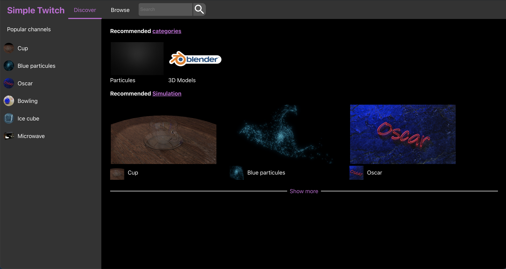
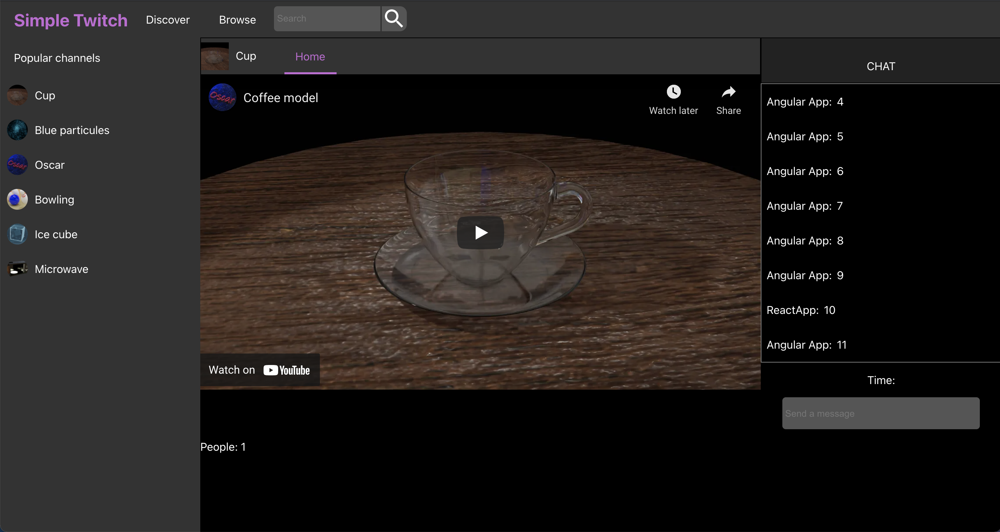

# SimpleTwitch

**Web**: https://st-react.codename-project.com

**Description:** Channel-based platform for showing videos and 3D models.

**Features**:
* Discover: Recommendations list (categories and channels)
* Browse: List of categories and channels
* Channel: 
    * Content: YouTube video or 3D model
    * Chat: Comments
* Backend: 
    * Github: https://github.com/oscarjcg/st-dotnet

**Development environment**:
* **Operating system:** Windows 10 64-bit
* **React:**  19.3.1
* **Redux:** 5.0.1 (react-redux 9.3.1)
* **TypeScript:** 5 (`strict` mode, see `tsconfig.json`). Domain types live in `src/types.ts`; store types (`RootState`, `AppDispatch`, `AppThunk`) in `src/store/index.ts`

**Configuration (backend URLs)**:
* All URLs are in `.env` and are read in `src/config.js`:
    * `REACT_APP_API_URL`: API (axios)
    * `REACT_APP_SOCKET_URL`: chat socket.io server
    * `REACT_APP_MODELS_3D_URL`: 3D model viewer
* To use a local backend, create `.env.local` (not committed to git), for example:
    * `REACT_APP_API_URL=http://localhost:8086/`
* Restart `npm start` / the container after changing these values.

**Docker**:
* Start the dev server (http://localhost:3001). The first run installs packages into the `node_modules` volume.
    * `docker compose up`
* Production build (output in `build/`)
    * `docker compose run --rm st-react-build`
* After changing `package.json`, reinstall packages
    * `docker compose run --rm st-react npm install`
* Delete container (keeps image and `node_modules` volume)
    * `docker compose down`
* Delete container and `node_modules` volume (clean reinstall on next start)
    * `docker compose down -v`

**Tests** (all with Docker; the backend is mocked, so no network or backend is needed):
* Type check (Jest does not check types, the dev server and `build` do but skip test files)
    * `docker compose run --rm st-react npm run typecheck`
* Unit tests (Jest + Testing Library), `*.test.ts(x)` next to each file in `src/`
    * Once: `docker compose run --rm st-react-test`
    * Watch mode: `docker compose run --rm st-react npm test`
    * Coverage (in `coverage/`): `docker compose run --rm st-react npm run test:coverage`
* UI tests (Playwright + Chromium), in `e2e/`. They start their own dev server inside the container
    * `docker compose run --rm st-react-e2e`
    * A single file: `docker compose run --rm st-react-e2e npx playwright test e2e/search.spec.js`
    * HTML report and failure traces in `playwright-report/` and `test-results/`
    * Fake backend data: `e2e/fixtures/data.js`, mocks: `e2e/support/mockApi.js`
* When updating `@playwright/test` in `package.json`, also change the `mcr.microsoft.com/playwright:vX.Y.Z-noble` image in `docker-compose.yml` (they must match).
