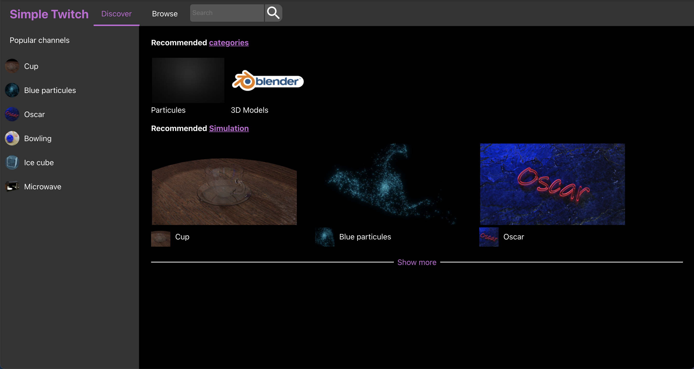
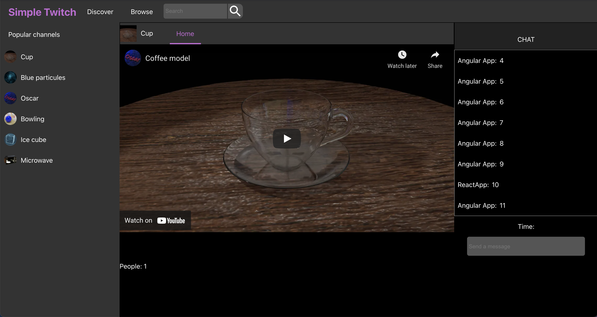

# SimpleTwitch (En desarrollo)

**Web (En desarrollo)**: https://st-react.codename-project.com

**Descripción:** Plataforma basaba en canales para mostrar videos y modelos 3D.

**Características**:
* Discover: Lista de recomendaciones (Categorias y canales)
* Browse: Lista de categorias y canales
* Canal: 
    * Contenido: Video de Youtube o modelo 3D
    * Chat: Comentarios
* Backend: 
    * Github: https://github.com/oscarjcg/simple-twitch-backend-laravel

**Entorno de desarrollo**:
* **Sistema operativo:** Windows 10 64 bits
* **React:**  19.3.1
* **Redux:** 5.0.1 (react-redux 9.3.1)

**Configuración (URLs del backend)**:
* Todas las URLs están en `.env` y se leen en `src/config.js`:
    * `REACT_APP_API_URL`: API (axios)
    * `REACT_APP_SOCKET_URL`: servidor socket.io del chat
    * `REACT_APP_MODELS_3D_URL`: visor de modelos 3D
* Para usar un backend local, crea `.env.local` (no se sube a git), por ejemplo:
    * `REACT_APP_API_URL=http://localhost:8086/`
* Reinicia `npm start` / el contenedor después de cambiar estos valores.

**Docker**:
* Run container with shell
    * `docker compose run --rm -p 3001:3000 st-react bash`
* Inside container install packages and exit
	* `npm install`
	* `exit`
* Run docker compose and it will start npm start (http://localhost:3001)
    * `docker compose up`
* Delete container (not image and node_modules)
    * `docker compose down`
